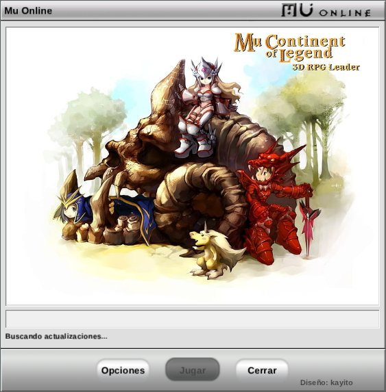
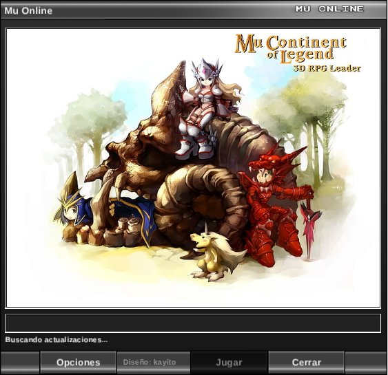
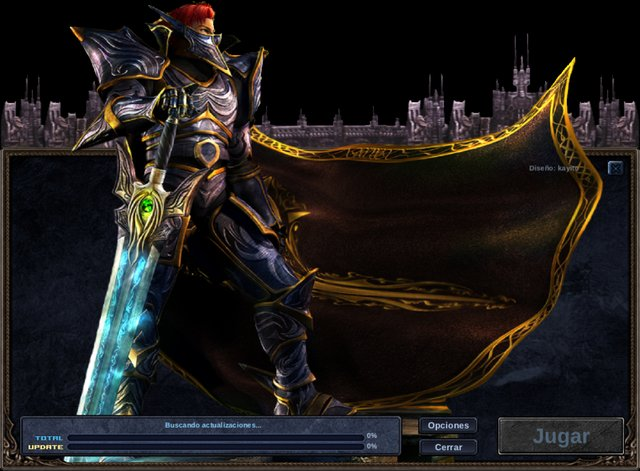
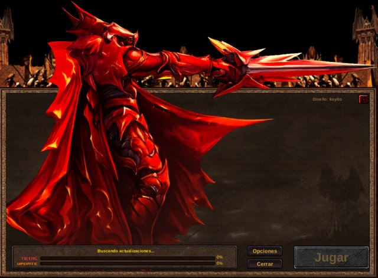
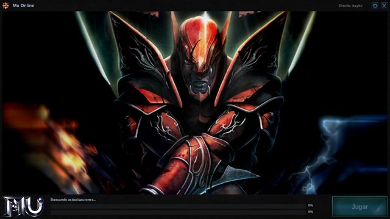
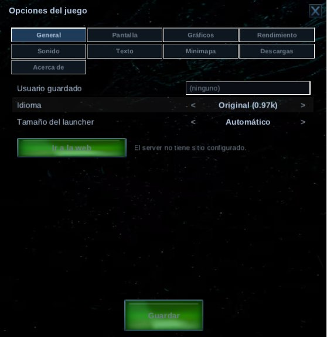

# Your server's launcher

[Español](launcher.md) · English · [Português](launcher.pt-BR.md)

The launcher installs and updates your players' client:

- it downloads the **base client** from the project's Releases, and the **music**
  and **HD textures** as optional content (players can play while they download);
- it downloads **your server's files** (your `main.exe`, your launcher, anything
  you add), see [parches-del-launcher.md](parches-del-launcher.md) (Spanish);
- it **updates itself**;
- it has the **game options** (display, graphics, sound, text...) and follows the
  language the player chose for the game (Spanish, English or Portuguese);
- it shows your server's website (on Windows) and the news you publish.

Each server builds its own, because it carries its server's address and key. No
programming needed: pick a design and fill in a few fields.

## Pick a design

All five designs are by **kayito** (NicoMuratona), taken from his
[kayito-MuLauncher](https://github.com/nicomuratona/kayito-MuLauncher) with his
permission, based on the original Webzen launchers.

| Design | | |
|---|---|---|
| `WebzenOldSchoolV1` |  | Light, 450×458. The panel always shows the image; the website opens from Options. |
| `WebzenOldSchoolV2` |  | Dark, 450×436. |
| `WebzenClassicV1` |  | Blue, 792×582, shaped (the surroundings are transparent). |
| `WebzenClassicV2` |  | The same in gold and red. |
| `WebzenModern` |  | 1024×576, with the image or the website almost edge to edge. |

In all of them except OldSchool V1, on Windows the large panel shows your
server's website (`MU_LAUNCHER_WEB_URL`); while it loads, or on Linux, it shows
the design's image.

The options are the same in all of them, in each design's colors (the texts
follow the player's language):



## What it carries

| Field | What for | Where it comes from |
|---|---|---|
| ConnectServer | Where it asks for the launcher configuration. | `host:port` of your ConnectServer (the usual 44405). Several, separated by commas. |
| Server public key | Proves the configuration and the patches are yours. | The GameServer log at startup: `[ServerIdentity] Clave publica: ...` (64 digits). See [identidad-del-server.md](identidad-del-server.md) (Spanish). |
| Title | The window name. | Anything you like. |

Those three are enough: the rest (patch channel and URL, website, news) is
announced by your server (the `MU_UPDATE_*` and `MU_LAUNCHER_*` variables in
[parches-del-launcher.md](parches-del-launcher.md)) and can change without
rebuilding the launcher. They can also be fixed at build time, as a fallback.

If you publish your own base client (a fork), its public key goes in too.

## Build it with GitHub Actions

Nothing to install:

1. Fork this repository and enable Actions in your fork.
2. Actions > **Launcher para tu server** > **Run workflow**.
3. Pick the design and fill in the ConnectServer, the server key and the title.
4. When it finishes (a few minutes), download `launcher-<design>-Windows` and
   `launcher-<design>-Linux` from the run's artifacts. The Linux one is an
   AppImage: a single file, with OpenSSL inside, that runs on any distro.

Artifacts are deleted after 90 days: keep the executables.

## Build it by hand

Windows, with Visual Studio 2022 (C++) and CMake:

```bash
cmake -S client/src/launcher -B build/launcher -DMU_LAUNCHER_THEME=WebzenModern -DMU_LAUNCHER_TITLE="My Server" -DMU_CONNECT_SERVER=mu.myserver.com:44405 -DMU_OVERLAY_KEY=<64 digits>
```

```bash
cmake --build build/launcher --config Release --target launcher
```

The result is `build/launcher/Release/launcher.exe`.

Linux: the same, with these dependencies (Debian/Ubuntu), `-DCMAKE_BUILD_TYPE=Release`
in the first command and no `--config` in the second:

```bash
sudo apt-get install libssl-dev libx11-dev libx11-xcb-dev libxext-dev libxrandr-dev libxinerama-dev libxcursor-dev libxi-dev libgl1-mesa-dev libegl-dev libasound2-dev libpulse-dev libwayland-dev libxkbcommon-dev libdecor-0-dev wayland-protocols pkg-config cmake g++
```

The result is `build/launcher/launcher`. That binary uses the distro's
OpenSSL 3; for an AppImage that runs anywhere (it downloads the linuxdeploy tool):

```bash
bash client/src/launcher/packaging/appimage.sh build/launcher/launcher launcher "My Server"
```

Other options: `-DMU_OVERLAY_CHANNEL`, `-DMU_OVERLAY_URL`, `-DMU_WEB_URL` (normally
announced by the server) and `-DMU_BASE_KEY` (your own base).

## Distribute it

- **The launcher goes in `Launcher/`**, inside the game folder
  (`Launcher/launcher.exe` on Windows, `Launcher/launcher` on Linux). That is
  where its own patch puts it, so it is the only place where it updates itself.
  The first time it is opened, the launcher offers to create a shortcut on the
  desktop and in the Start menu (on Linux, the applications menu); it is also in
  Options > General.
- **To update it**, upload the new one in a patch, under `Launcher/` (see
  [parches-del-launcher.md](parches-del-launcher.md)). It is downloaded before
  everything else and the launcher restarts.
- **Installing from scratch**: the launcher alone in an empty folder
  (`MyServer/Launcher/launcher.exe`) downloads the whole client. This works from
  0.97.50, the first Release with the base published.
- **Play only through the launcher**: optional, enabled by the server
  (`MU_LAUNCHER_REQUIRED`, see [parches-del-launcher.md](parches-del-launcher.md)).
- **Windows**: the executable is not signed with a code-signing certificate, so
  SmartScreen may warn the first time.
- **Linux**: the AppImage goes the same way, as `Launcher/launcher`. It needs a
  graphical session (X11 or Wayland). If the file lost its execute permission,
  `chmod +x Launcher/launcher`.

The player's preferences are stored in `launcher.toml` (downloads, window size)
and `Config.ini` (the game's), inside `User/` on Windows and in the game folder
on Linux.
