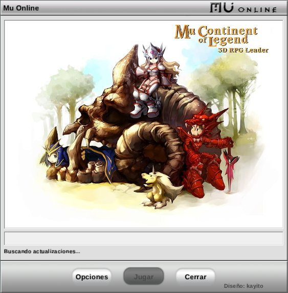
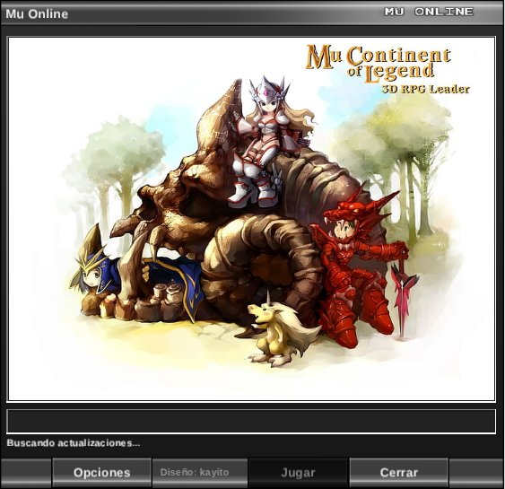
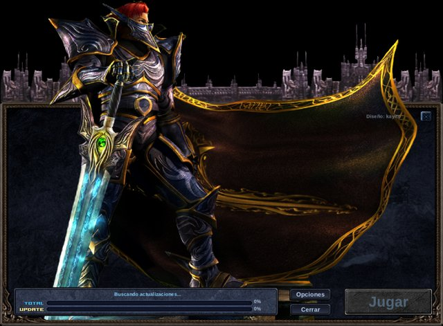
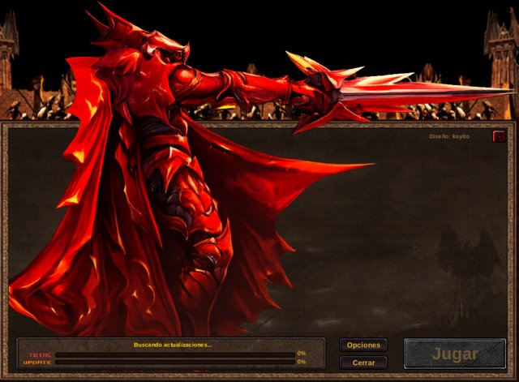
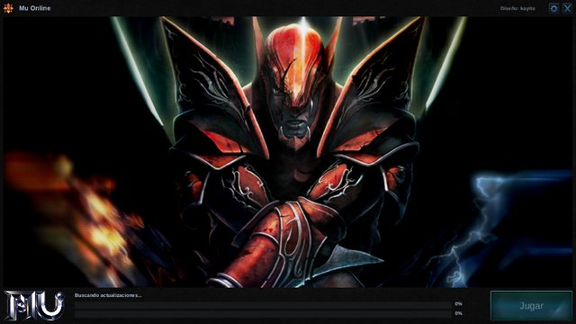
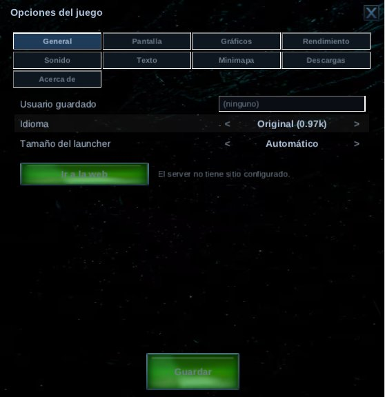

# Launcher de tu server

Español · [English](launcher.en.md) · [Português](launcher.pt-BR.md)

El launcher instala y actualiza el cliente de tus jugadores:

- baja el **cliente base** de los Releases del proyecto, y la **música** y las
  **texturas HD** como opcionales (se puede jugar mientras bajan);
- baja **los archivos de tu server** (tu `main.exe`, tu launcher, lo que agregues),
  ver [parches-del-launcher.md](parches-del-launcher.md);
- se **actualiza solo**;
- tiene las **opciones del juego** (pantalla, gráficos, sonido, texto...) y sale en
  el idioma que el jugador eligió para el juego (castellano, inglés o portugués);
- muestra la web de tu server (en Windows) y las noticias que publiques.

Cada server arma el suyo, porque lleva la dirección y la clave de su server. No
hace falta programar: se elige un diseño y se completan unos datos.

## Elegir el diseño

Los cinco diseños son de **kayito** (NicoMuratona), tomados de su
[kayito-MuLauncher](https://github.com/nicomuratona/kayito-MuLauncher) con su
permiso, sobre los launchers originales de Webzen.

| Diseño | | |
|---|---|---|
| `WebzenOldSchoolV1` |  | Claro, 450×458. En el panel muestra siempre la imagen; la web se abre desde Opciones. |
| `WebzenOldSchoolV2` |  | Oscuro, 450×436. |
| `WebzenClassicV1` |  | Azul, 792×582, con forma (lo de alrededor es transparente). |
| `WebzenClassicV2` |  | El mismo en dorado y rojo. |
| `WebzenModern` |  | 1024×576, con la imagen o la web casi de borde a borde. |

En todos menos el OldSchool V1, en Windows el panel grande muestra la web de tu
server (`MU_LAUNCHER_WEB_URL`, ver [parches-del-launcher.md](parches-del-launcher.md));
mientras no carga, o en Linux, muestra la imagen del diseño.

Las opciones son iguales en todos, con los colores de cada diseño (los textos
siguen el idioma del jugador):



## Qué datos lleva

| Dato | Para qué | De dónde sale |
|---|---|---|
| ConnectServer | Ahí pregunta la configuración del launcher. | `host:puerto` de tu ConnectServer (el 44405 de siempre). Varios, separados por coma. |
| Clave pública del server | Con ella verifica que la configuración y los parches son tuyos. | El log del GameServer al arrancar: `[ServerIdentity] Clave publica: ...` (64 dígitos). Ver [identidad-del-server.md](identidad-del-server.md). |
| Título | El nombre de la ventana. | El que quieras. |

Con esos tres alcanza: el resto (canal y URL de los parches, sitio, noticias) lo
anuncia tu server (las variables `MU_UPDATE_*` y `MU_LAUNCHER_*` de
[parches-del-launcher.md](parches-del-launcher.md)), y se puede cambiar sin
volver a armar el launcher. También se pueden fijar al armarlo, como respaldo.

Si publicás tu propia base del cliente (un fork), además va su clave pública.

## Armarlo con GitHub Actions

No hace falta instalar nada:

1. Hacé un fork de este repositorio y, en tu fork, habilitá Actions.
2. Actions > **Launcher para tu server** > **Run workflow**.
3. Elegí el diseño y completá el ConnectServer, la clave del server y el título.
4. Al terminar (unos minutos), bajá de los artefactos del run
   `launcher-<diseño>-Windows` y `launcher-<diseño>-Linux`. El de Linux es un
   AppImage: un solo archivo, con OpenSSL adentro, que corre en cualquier
   distro.

Los artefactos se borran a los 90 días: guardá los ejecutables.

## Armarlo a mano

Windows, con Visual Studio 2022 (C++) y CMake:

```bash
cmake -S client/src/launcher -B build/launcher -DMU_LAUNCHER_THEME=WebzenModern -DMU_LAUNCHER_TITLE="Mi Server" -DMU_CONNECT_SERVER=mu.miserver.com:44405 -DMU_OVERLAY_KEY=<64 dígitos>
```

```bash
cmake --build build/launcher --config Release --target launcher
```

Queda en `build/launcher/Release/launcher.exe`.

Linux: lo mismo, con estas dependencias (Debian/Ubuntu), `-DCMAKE_BUILD_TYPE=Release` en el primer comando y sin `--config` en el segundo:

```bash
sudo apt-get install libssl-dev libx11-dev libx11-xcb-dev libxext-dev libxrandr-dev libxinerama-dev libxcursor-dev libxi-dev libgl1-mesa-dev libegl-dev libasound2-dev libpulse-dev libwayland-dev libxkbcommon-dev libdecor-0-dev wayland-protocols pkg-config cmake g++
```

Queda en `build/launcher/launcher`. Ese binario usa el OpenSSL 3 de la distro;
para un AppImage que corra en cualquiera (baja la herramienta linuxdeploy):

```bash
bash client/src/launcher/packaging/appimage.sh build/launcher/launcher launcher "Mi Server"
```

Otras opciones: `-DMU_OVERLAY_CHANNEL`, `-DMU_OVERLAY_URL`, `-DMU_WEB_URL` (las
que normalmente anuncia el server) y `-DMU_BASE_KEY` (tu propia base).

## Repartirlo

- **El launcher va en `Launcher/`**, dentro de la carpeta del juego
  (`Launcher/launcher.exe` en Windows, `Launcher/launcher` en Linux). Ahí es
  donde lo pone su propio parche, así que es el único lugar donde se actualiza
  solo. La primera vez que lo abren, el launcher ofrece crear un acceso directo
  en el escritorio y en el menú de inicio (en Linux, el menú de aplicaciones);
  también está en Opciones > General.
- **Para actualizarlo**, subí el nuevo en un parche, en `Launcher/` (ver
  [parches-del-launcher.md](parches-del-launcher.md)). Lo baja antes que todo lo
  demás y se reinicia.
- **Instalación desde cero**: el launcher solo, en una carpeta vacía
  (`MiServer/Launcher/launcher.exe`), baja el cliente entero. Funciona desde la
  0.97.50, que es el primer Release con la base publicada.
- **Jugar sólo desde el launcher**: opcional, lo activa el server
  (`MU_LAUNCHER_REQUIRED`, ver [parches-del-launcher.md](parches-del-launcher.md)).
- **Windows**: el ejecutable no está firmado con un certificado de código, así
  que SmartScreen puede avisar la primera vez.
- **Linux**: el AppImage va igual, como `Launcher/launcher`. Necesita una sesión
  gráfica (X11 o Wayland). Si el archivo perdió el permiso de ejecución,
  `chmod +x Launcher/launcher`.

Las preferencias del jugador quedan en `launcher.toml` (descargas, tamaño de la
ventana) y en `Config.ini` (las del juego), dentro de `User/` en Windows y en la
carpeta del juego en Linux.
