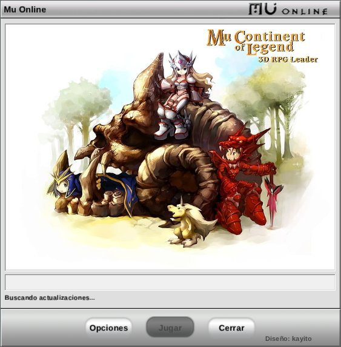
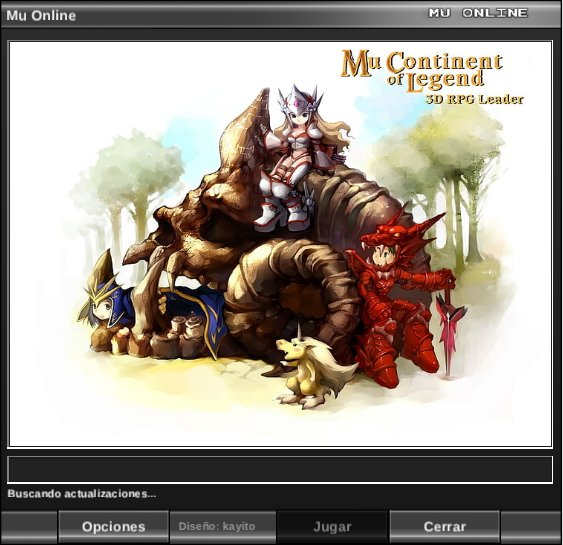
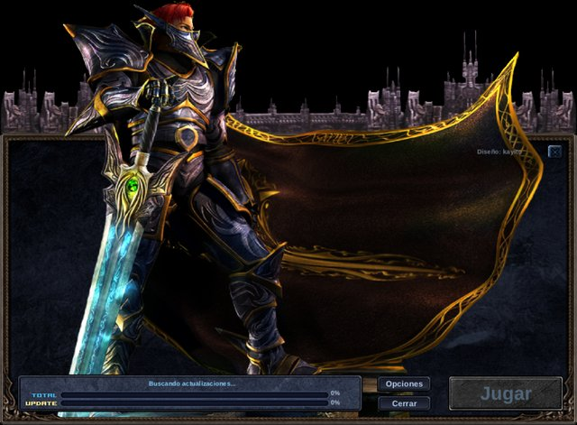
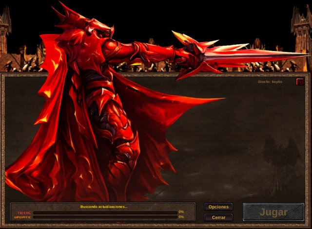
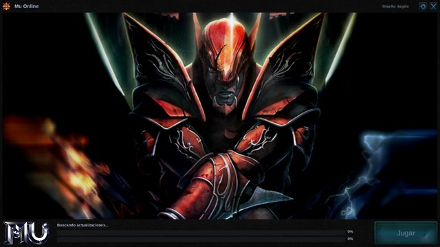
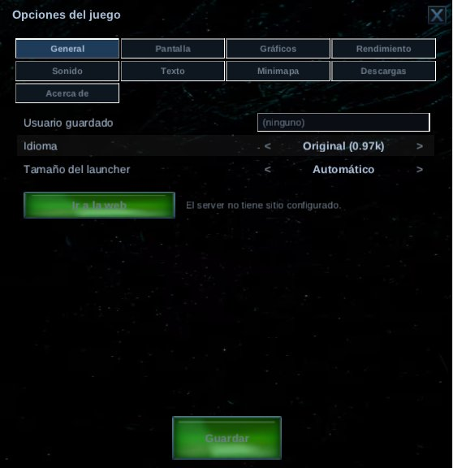

# O launcher do seu servidor

[Español](launcher.md) · [English](launcher.en.md) · Português

O launcher instala e atualiza o cliente dos seus jogadores:

- baixa o **cliente base** dos Releases do projeto, e a **música** e as
  **texturas HD** como opcionais (dá para jogar enquanto baixam);
- baixa **os arquivos do seu servidor** (o seu `main.exe`, o seu launcher, o que
  você adicionar), veja [parches-del-launcher.md](parches-del-launcher.md)
  (em espanhol);
- **atualiza a si mesmo**;
- tem as **opções do jogo** (tela, gráficos, som, texto...) e aparece no idioma
  que o jogador escolheu para o jogo (espanhol, inglês ou português);
- mostra o site do seu servidor (no Windows) e as notícias que você publicar.

Cada servidor monta o seu, porque ele leva o endereço e a chave do servidor. Não
é preciso programar: escolhe-se um design e preenchem-se alguns dados.

## Escolher o design

Os cinco designs são de **kayito** (NicoMuratona), tirados do seu
[kayito-MuLauncher](https://github.com/nicomuratona/kayito-MuLauncher) com a
permissão dele, sobre os launchers originais da Webzen.

| Design | | |
|---|---|---|
| `WebzenOldSchoolV1` |  | Claro, 450×458. O painel mostra sempre a imagem; o site abre pelas Opções. |
| `WebzenOldSchoolV2` |  | Escuro, 450×436. |
| `WebzenClassicV1` |  | Azul, 792×582, com forma (o redor é transparente). |
| `WebzenClassicV2` |  | O mesmo em dourado e vermelho. |
| `WebzenModern` |  | 1024×576, com a imagem ou o site quase de ponta a ponta. |

Em todos menos o OldSchool V1, no Windows o painel grande mostra o site do seu
servidor (`MU_LAUNCHER_WEB_URL`); enquanto não carrega, ou no Linux, mostra a
imagem do design.

As opções são iguais em todos, com as cores de cada design (os textos seguem o
idioma do jogador):



## Que dados ele leva

| Dado | Para quê | De onde sai |
|---|---|---|
| ConnectServer | Onde ele pergunta a configuração do launcher. | `host:porta` do seu ConnectServer (o 44405 de sempre). Vários, separados por vírgula. |
| Chave pública do servidor | Comprova que a configuração e os patches são seus. | O log do GameServer ao iniciar: `[ServerIdentity] Clave publica: ...` (64 dígitos). Veja [identidad-del-server.md](identidad-del-server.md) (em espanhol). |
| Título | O nome da janela. | O que você quiser. |

Esses três bastam: o resto (canal e URL dos patches, site, notícias) é anunciado
pelo seu servidor (as variáveis `MU_UPDATE_*` e `MU_LAUNCHER_*` de
[parches-del-launcher.md](parches-del-launcher.md)) e pode mudar sem montar o
launcher de novo. Também podem ser fixados ao montá-lo, como reserva.

Se você publica a sua própria base do cliente (um fork), também vai a chave
pública dela.

## Montar com o GitHub Actions

Não é preciso instalar nada:

1. Faça um fork deste repositório e, no seu fork, habilite o Actions.
2. Actions > **Launcher para tu server** > **Run workflow**.
3. Escolha o design e preencha o ConnectServer, a chave do servidor e o título.
4. Ao terminar (alguns minutos), baixe dos artefatos da execução
   `launcher-<design>-Windows` e `launcher-<design>-Linux`.

Os artefatos são apagados depois de 90 dias: guarde os executáveis.

## Montar à mão

Windows, com o Visual Studio 2022 (C++) e o CMake:

```bash
cmake -S client/src/launcher -B build/launcher -DMU_LAUNCHER_THEME=WebzenModern -DMU_LAUNCHER_TITLE="Meu Servidor" -DMU_CONNECT_SERVER=mu.meuservidor.com:44405 -DMU_OVERLAY_KEY=<64 dígitos>
```

```bash
cmake --build build/launcher --config Release --target launcher
```

Fica em `build/launcher/Release/launcher.exe`.

Linux: o mesmo, com estas dependências (Debian/Ubuntu), `-DCMAKE_BUILD_TYPE=Release`
no primeiro comando e sem `--config` no segundo:

```bash
sudo apt-get install libssl-dev libx11-dev libx11-xcb-dev libxext-dev libxrandr-dev libxinerama-dev libxcursor-dev libxi-dev libgl1-mesa-dev libegl-dev libasound2-dev libpulse-dev libwayland-dev libxkbcommon-dev libdecor-0-dev wayland-protocols pkg-config cmake g++
```

Fica em `build/launcher/launcher`.

Outras opções: `-DMU_OVERLAY_CHANNEL`, `-DMU_OVERLAY_URL`, `-DMU_WEB_URL` (as que
normalmente o servidor anuncia) e `-DMU_BASE_KEY` (a sua própria base).

## Distribuir

- **O launcher vai em `Launcher/`**, dentro da pasta do jogo
  (`Launcher/launcher.exe` no Windows, `Launcher/launcher` no Linux). É onde o
  próprio patch o coloca, então é o único lugar em que ele se atualiza sozinho.
  Para os jogadores, um atalho.
- **Para atualizá-lo**, envie o novo num patch, em `Launcher/` (veja
  [parches-del-launcher.md](parches-del-launcher.md)). Ele é baixado antes de
  tudo e o launcher reinicia.
- **Instalação do zero**: o launcher sozinho numa pasta vazia
  (`MeuServidor/Launcher/launcher.exe`) baixa o cliente inteiro. Funciona a
  partir da 0.97.50, o primeiro Release com a base publicada.
- **Jogar só pelo launcher**: opcional, quem ativa é o servidor
  (`MU_LAUNCHER_REQUIRED`, veja [parches-del-launcher.md](parches-del-launcher.md)).
- **Windows**: o executável não é assinado com um certificado de código, então o
  SmartScreen pode avisar na primeira vez.
- **Linux**: precisa de uma sessão gráfica (X11 ou Wayland). Se o arquivo perdeu a
  permissão de execução, `chmod +x Launcher/launcher`.

As preferências do jogador ficam em `launcher.toml` (downloads, tamanho da janela)
e em `Config.ini` (as do jogo), dentro de `User/` no Windows e na pasta do jogo no
Linux.
